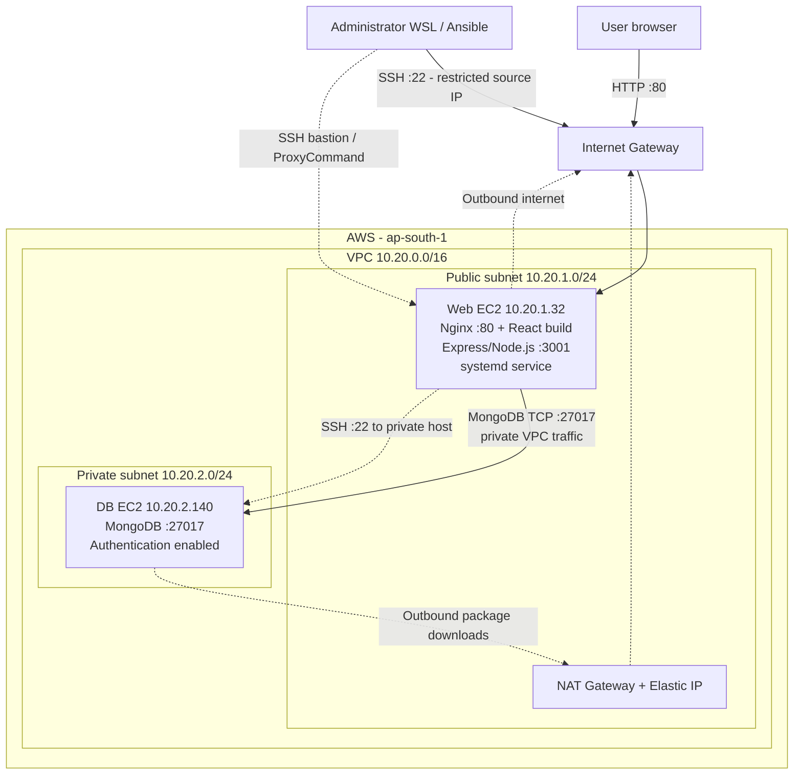
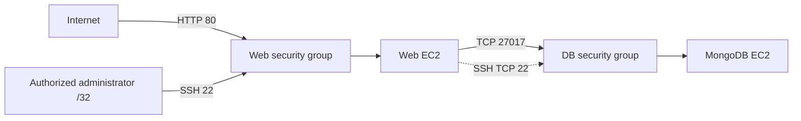
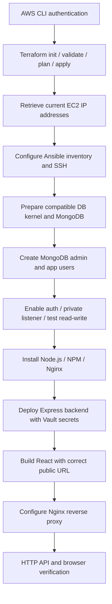

# TravelMemory MERN Deployment — AWS Architecture

## 1. Logical and infrastructure architecture

The deployment uses **two EC2 instances** in a dedicated AWS VPC: a web/application server in a public subnet and a MongoDB server in a private subnet. Terraform provisions the AWS infrastructure. Ansible configures both operating systems and deploys the application.

**Diagram notes:** Nginx and Express are on the *same* web EC2. Nginx serves static React files and reverse-proxies API calls locally to Express. The database has no public IP. The NAT Gateway supports outbound connections from the private subnet; it does not accept unsolicited public inbound traffic to MongoDB.

## 2. Subnets, routes and addressing

| Component | Value | Purpose |
|---|---|---|
| Region | `ap-south-1` | Mumbai deployment region |
| VPC | `10.20.0.0/16` | Isolated AWS network |
| Public subnet | `10.20.1.0/24` | Web EC2 and NAT Gateway |
| Private subnet | `10.20.2.0/24` | MongoDB EC2 |
| Web private IP | `10.20.1.32` | Internal app host address |
| DB private IP | `10.20.2.140` | MongoDB endpoint |
| Observed web public IP | `13.234.78.43` | Example only; changes after stop/start unless pinned |
| Public default route | `0.0.0.0/0` via Internet Gateway | Inbound/outbound internet for public subnet |
| Private default route | `0.0.0.0/0` via NAT Gateway | Outbound internet for private subnet |

The NAT Gateway is located in the public subnet, has an Elastic IP, and uses the Internet Gateway. This enables installing/updating software on the private DB server without exposing that server to inbound internet traffic.

## 3. Application request flows

### Frontend/static content

1. Browser requests `http://<current-web-public-ip>/` on TCP port 80.
2. The web security group allows HTTP. Nginx returns `index.html` and the built React assets from `/var/www/travelmemory`.
3. React renders the TravelMemory interface in the browser.

### API and database

1. React uses `REACT_APP_BACKEND_URL` set at **build time** to the web server's HTTP origin.
2. Browser calls `/trip` (or `/trip/:id`) on port 80.
3. Nginx forwards `/trip` to Express on `127.0.0.1:3001`.
4. Express authenticates to `10.20.2.140:27017` using the `travelmemory_app` account and `travelmemory` authentication database.
5. MongoDB returns data to Express, which returns JSON through Nginx to the browser.

For example, on 20 October 2026, public tests returned HTTP `200` for `/`, `Hello World!` for `/hello`, and `[]` for `/trip` before sample data was added. These verify routing and the API read path. Browser write/persistence must be verified separately.

## 4. Security boundaries

| Security control | Implementation |
|---|---|
| Internet exposure | Only web instance has a public IPv4 address |
| HTTP access | TCP 80 allowed to Nginx on web EC2 |
| Web SSH | TCP 22 restricted to an authorized administrator IP/CIDR |
| Database SSH | TCP 22 allowed from web security group; SSH ProxyCommand via web host |
| Database traffic | TCP 27017 permitted from web security group only |
| MongoDB binding | `127.0.0.1,10.20.2.140` |
| MongoDB access control | `security.authorization: enabled` |
| DB users | `mernadmin` administrator; `travelmemory_app` readWrite on `travelmemory` |
| Secrets | Ansible Vault locally; generated backend environment file restricted on web EC2 |
| Instance identity | IAM roles/instance profiles, with SSM-related permissions |
| Instance remote access | SSH private key outside Git; SSH host-key checks enabled |

**Security limitations:** HTTP is unencrypted. The browser embeds a public IP for the API origin. This is an educational deployment rather than a production reference architecture; a production version should use HTTPS/DNS, better secret management, instance patching, observability, backups and resiliency controls.

## 5. Terraform-to-Ansible responsibilities

| Terraform | Ansible |
|---|---|
| Defines AWS provider and region | Configures Ubuntu instances over SSH |
| Creates VPC, subnets, routes, IGW, NAT | Installs MongoDB, PyMongo support and database user configuration |
| Creates security groups and IAM roles | Enables MongoDB authentication/private binding |
| Creates web/database EC2 instances | Installs Node.js, NPM, Git and Nginx |
| Outputs public/private addresses | Deploys Express systemd service, React build and Nginx reverse proxy |

The Ansible operator resides on WSL Ubuntu. It reaches the web EC2 directly over SSH, then reaches the private EC2 through an SSH `ProxyCommand` tunnel via the web host.

## 6. Provisioning and deployment sequence

## 7. Operational notes

**Database kernel compatibility.** The initial DB EC2 image booted Linux `7.0.0-1014-aws`; MongoDB 8.0.34 refused to start. Installing/booting `6.8.0-1067-aws` on the DB EC2 fixed this. The web EC2 was observed running kernel 7.x and did not require the MongoDB-specific workaround.

**Public IP lifecycle.** The web EC2 was stopped and restarted during deployment. Its public IP changed from `13.232.127.188` to `13.234.78.43`; the Ansible inventory and database bastion ProxyCommand were updated, and the new SSH host key was verified before continuing. A fixed Elastic IP or domain would reduce this operational coupling.

**Application process lifecycle.** Express runs as `travelmemory-backend` under systemd. MongoDB and Nginx are systemd services; services should be checked after instance restart. React is served as static files, so it does not require a separate development server.

**Cost and cleanup.** EC2, EBS storage, NAT Gateway and public IPv4 allocation can incur charges. After final acceptance, use the corresponding Terraform state to review and destroy this project's resources if they are no longer needed.
